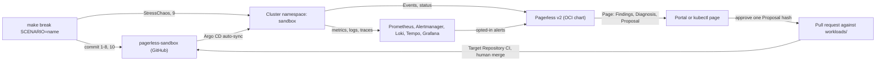

# pagerless-sandbox

The worked showcase for [**Pagerless**](https://github.com/a-hagi613/pagerless) v2: the OpenTelemetry Demo shopping cart, a GitOps control plane, an observability and chaos stack, Terraform for an Amazon EKS session, ten repeatable failures, and a teardown that has to leave nothing billable behind.

Pagerless itself — the server, the agent Job, the chart, the `kubectl page` plugin and the embedded Portal — is not in this repository. The showcase installs it the way a stranger does: as a pinned OCI chart, from `platform/apps`. No product source, no local chart copy, and nothing cloned from the product repository at run time.

## How the showcase runs



- **`platform/`** is the Argo CD app-of-apps: Argo CD's own values, the root Application, one child Application per component, and the observability, Chaos Mesh and cloud manifests they read.
- **`workloads/`** is the demo, committed as plain manifests so a Scenario is an ordinary reviewable commit and Argo CD needs no Helm.
- **`infra/`** is the Terraform for the EKS session: network, cluster, Karpenter, storage, and the two keyless CI roles.
- **`scenarios/`** is the ten injections: nine patches against `workloads/`, and one Chaos Mesh experiment applied outside Git.

## Quick start

Two paths run the same platform: a local [kind](https://kind.sigs.k8s.io/) cluster, and an Amazon EKS session. Both start from the same local configuration, which `make configure` prompts for and writes to the git-ignored `.env`:

- the HTTPS URL of the repository that holds `workloads/` (this repository, or your fork);
- a fine-grained GitHub token with `Contents: read` on it, which Argo CD uses to sync;
- a fine-grained GitHub token with `Contents: write` and `Pull requests: write` on it, which Pagerless uses to open the pull request that carries a Proposal;
- an OpenAI-compatible model endpoint: its base URL, its API key (empty for a keyless local endpoint), and the model name.

```bash
make configure

make up          # kind: create the cluster, install Argo CD, sync the platform and the demo
# or
make cloud-up    # EKS: apply Terraform, install Karpenter, then the same bootstrap
```

When it returns, the Applications are synced and the demo is healthy:

```bash
kubectl --context kind-pagerless -n argocd get applications
kubectl --context kind-pagerless -n sandbox get pods
```

The bootstrap prints the Portal's port-forward and the command that reads the bootstrap token from `pagerless-admin-secret`. Sign in with that token, or configure the terminal instead:

```bash
kubectl --context kind-pagerless -n pagerless port-forward svc/pagerless-server 8080:8080
kubectl --context kind-pagerless -n pagerless get secret pagerless-admin-secret \
  -o jsonpath='{.data.token}' | base64 --decode; echo

kubectl page config set        # server URL and optional session token, no credential in argv
```

Inject a failure, and restore the repository when you are done:

```bash
make scenarios                       # list the ten Scenarios
make break SCENARIO=oom              # commit it, wait for the merge, wait for the fault
make break SCENARIO=cpu              # apply the Chaos Mesh experiment outside Git
make reset                           # delete the experiment, restore the demo tree from known-good
```

Tear down:

```bash
make down        # delete the kind cluster
make cloud-down  # destroy the EKS session and prove nothing billable remains
```

## The v2 flow

1. **A Trigger opens a Page.** A Kubernetes Warning Event or a status transition is observed by the watcher, an opted-in alert arrives on the alert webhook, or a human asks for a Target with `kubectl page`. `pagerless.dev/watch: "true"` is the v2 alert opt-in.
2. **One Active Page per Fingerprint.** Repeat Triggers join that Page and are counted; a Cooldown keeps a flapping failure from opening and billing a new investigation every minute.
3. **The server investigates.** An ephemeral agent Job, with no cluster RBAC and no GitHub token, reads a bounded Context Bundle through the server's tool broker and reports Findings, a Diagnosis and a Proposal.
4. **A human decides.** The Proposal is validated against the Target Repository and the cluster's schemas, then bound to a hash. The operator approves that exact hash in the Portal or with `kubectl page approve`; a rejection is final for the Page.
5. **Pagerless opens one pull request.** The isolated writer opens it against the Target Repository, and that repository's Checks decide whether it may merge. Pagerless never merges, never patches the cluster and never holds a write credential for it.
6. **Verification closes the Page.** After the merge, deterministic checks observe the Target and end the Page as `Recovered` or `NotRecovered`; the Portal and `kubectl page show` carry the evidence, the decision and who made it.

## The product is a released artefact

`platform/apps/templates/pagerless.yaml` installs Pagerless from `oci://ghcr.io/a-hagi613/charts/pagerless` at the pinned `targetRevision`, with [`values/pagerless.yaml`](values/pagerless.yaml) as its values and a `$values` ref to this repository. Argo CD takes a chart's registry and namespace in `repoURL` and the chart name in `chart`, so the source reads `ghcr.io/a-hagi613/charts` with `chart: pagerless`; the `oci://` scheme belongs to the artefact reference, not to that field.

The pin is **2.0.0**, the v2 chart. That chart is standalone: it runs one `pagerless-server` Deployment, the Page history claim and a strictly read-only cluster identity, and reads its credentials from an existing Secret. It needs no database, identity provider, message broker, agent gateway, MCP server or admission webhook.

The install is configured the way a v2 operator configures it:

- `auth.mode: token`. The chart does not generate the bootstrap token here, because Argo CD renders with `helm template` and would rotate it on every sync; `hack/bootstrap-stack.sh` creates `pagerless-admin-secret` once and the Portal exchanges that token for a session.
- `credentials.existingSecret: pagerless-credentials`. One Secret, one key per credential: `AI_BASE_URL`, `AI_API_KEY`, `AI_MODEL`, `GITHUB_TOKEN`, `GITHUB_REPO`, optional `GITHUB_API_URL`. [`values/pagerless-secrets.example.yaml`](values/pagerless-secrets.example.yaml) documents the shape, and nothing secret is committed.
- `rbac.watchAllNamespaces: true`. The demo is one cluster, and cluster-wide read keeps Node evidence and `/openapi/v3` validation available.

There is no `pagerless-server` or `pagerless-executor` kustomize Application, and no bundled identity provider, agent gateway, MCP server or Gateway API CRDs Application. v2 deletes those services rather than vendoring them, and the chart creates everything it needs.

> The v2 alert-ingest contract is product ticket #90 (pull request #103). The showcase wires the receiver path, the Alertmanager bearer token and the `pagerless.dev/watch` opt-in exactly as that receiver implements them; if the contract changes before the chart release, the route and the labels move with it. The watcher opens Pages from Kubernetes Events and status independently.

## The Scenarios

A Scenario is one repeatable failure. `make break` injects it; `make reset` restores the paths it changed to their `known-good` contents.

| # | `SCENARIO` | Target | Fault |
| --- | --- | --- | --- |
| 1 | `oom` | checkout | `memory-holder` limited below the memory it allocates |
| 2 | `bad-config` | checkout | configuration the container refuses at start |
| 3 | `bad-image-tag` | checkout | container image tag that does not exist |
| 4 | `unschedulable` | checkout | memory request larger than any node offers |
| 5 | `cart-flag` | cart | `cartFailure` at 100% |
| 6 | `payment-flag` | payment | `paymentFailure` at 100% |
| 7 | `product-catalog-flag` | product-catalog | `productCatalogFailure` widened to `on` |
| 8 | `email-memory-leak` | email | `emailMemoryLeak` at `100x` |
| 9 | `cpu` | payment | `StressChaos` experiment, applied outside Git |
| 10 | `injection` | checkout | Scenario 1 plus a log line posing as an instruction |

[`docs/scenarios.md`](docs/scenarios.md) states what each injection changes and what it breaks. Every patch is proved applicable to `workloads/` by `make check` and by CI, so a Scenario cannot silently stop injecting anything.

## The known-good tag

The tag `known-good` marks the commit in which every Target is healthy, and `make reset` restores the demo tree to it. The tag is never moved or re-created by this repository's scripts or CI: `hack/reset.sh` only reads it. If `workloads/` must change, move the tag only after the new commit has been verified healthy on a live cluster, and record the previous target in the commit message.

A reset restores only the paths a Scenario can change: every file a `scenarios/*/inject.patch` edits, plus every path a Target declares as `pagerless.dev/source-path` or `pagerless.dev/depends-on-paths`. Those bytes come from the tag, and the reset commits them on top of the current `main` and pushes without force. Nothing else moves, so `platform/`, `infra/`, `values/`, the workflows and the rest of `workloads/` are never deleted from the branch. When the tree already matches `known-good`, the reset commits nothing and only waits for Argo CD and replaces the flag-driven pods.

A reset therefore needs no force push, and it no longer has to precede the teardown for `infra/` to survive: `main` always carries `infra/` and the workflows, so a session can end with `make reset` and then `make cloud-down`, or with `make cloud-down` alone. A reset still needs a running cluster, because it waits for Argo CD to sync the restore.

## Layout

| Path | Contents |
| --- | --- |
| `infra/` | Terraform: network, EKS, Karpenter, storage, and the two GitHub OIDC roles. `bootstrap/` creates the state bucket once; `ci/` creates the roles once. |
| `platform/argocd/` | Argo CD's own installation values. |
| `platform/root/` | The root app-of-apps Application. |
| `platform/apps/` | One child Application per component, including `pagerless.yaml`. |
| `platform/observability/` | Alert rules, Target dashboards, monitors, and the Helm values for Prometheus, Loki, Tempo and the collector. |
| `platform/chaos-mesh/` | The Chaos Mesh values for Scenario 9. |
| `platform/cloud/` | The Karpenter NodePool and EC2NodeClass templates and the default StorageClass. |
| `values/` | The chart values the showcase installs with, and a keys-only example of the credential, admin, session and alert Secrets it expects. |
| `scenarios/` | The ten injections. |
| `workloads/` | The rendered demo, one file per object. |
| `hack/` | The session lifecycle, the Scenario drivers, the teardown checks, the manifest validation, and the demo render scripts. |
| `docs/` | The EKS walkthrough, the Scenario catalogue, the cost and teardown guide, and the decision records. |

## Repository settings

CI validates what it can, but two settings are repository configuration rather than files:

1. **Auto-merge** enabled (Settings, General, Pull requests), so an injection's pull request merges as soon as its check passes.
2. **A branch protection rule on `main`** that requires the `kubeconform` status check. Every Scenario injection goes through a pull request, so this rule is what makes it wait for validation.

Force pushes no longer need to be allowed on `main`: `make reset` commits the restored paths on top of `main` and pushes without force, so the rule can be turned off. This repository does not change that setting for you.

The nightly teardown needs one more thing that is not a setting: the two roles in `infra/ci` applied once, and the repository named in `infra/ci/variables.tf` matching the repository the workflows run in.

## The demo

The Targets are a trimmed [OpenTelemetry Demo](https://opentelemetry.io/docs/demo/) 3.1.0: frontend, frontend-proxy, cart with its valkey store, checkout, payment, product-catalog with its astronomy database, email, flagd, shipping, quote, currency, kafka, and the load generator that drives them. Their telemetry goes to the OpenTelemetry Collector agent, which runs as a DaemonSet.

The subset is fixed by ADR-0019 in the product repository: ad, recommendation, accounting, fraud detection, image provider, chatbot, MCP, opamp-server, agent and telemetry-docs are disabled, as are the demo's own Jaeger, Prometheus, Grafana and OpenSearch, because this platform provides observability. The 15 Deployments declare 3.3 GiB of memory limits in total, and the collector declares 400 MiB on each node.

The collector's agent ports are container ports only. The chart normally publishes 4317, 4318, 6831, 9411, 14250 and 14268 as node host ports as well, but the platform's own collector DaemonSet owns those ports, and a single-node kind cluster can schedule only one DaemonSet per host port. `hack/render-values.yaml` therefore removes the host ports; the demo pods reach the collector through its Service.

The chart's default `flagd-ui` sidecar is also dropped. It serves a browser page for editing flags, which no Scenario uses, and it carries a hardcoded high-entropy session secret that must not enter a public repository. Scenarios change flags by committing to `flagd-config`.

The `flagd` Deployment mounts that ConfigMap at `/etc/flagd` read-only, rather than copying it into an emptyDir. Kubelet refreshes a mounted ConfigMap, so a merged change reaches the running flagd process without a pod restart and the SDK services pick up the new flags. `hack/check.py` fails if an init-container copy or an emptyDir mount returns.

## Rendering

The manifests are rendered from the pinned chart and committed as plain YAML, so that Argo CD deploys without Helm and every Scenario injection is an ordinary commit.

| Tool | Version |
| --- | --- |
| Helm | v4.3.2 |
| Chart `opentelemetry-demo` | 0.42.6, appVersion 3.1.0 |
| Chart repository | `https://open-telemetry.github.io/opentelemetry-helm-charts` |
| PyYAML | 6.0.3 |
| kubeconform | v0.8.0, Kubernetes 1.37.0 |

`hack/render.py` runs the pinned command, splits the output into one file per object, sets `namespace: sandbox` and adds the annotations:

```
helm template demo opentelemetry-demo \
  --repo https://open-telemetry.github.io/opentelemetry-helm-charts \
  --version 0.42.6 \
  --namespace sandbox \
  --values hack/render-values.yaml
```

To re-render, from the repository root:

```
python3 -m venv .venv
.venv/bin/pip install --requirement hack/requirements.txt
.venv/bin/python hack/render.py
kubeconform -strict -summary -kubernetes-version 1.37.0 workloads
.venv/bin/python hack/check.py
```

The script is deterministic: the same chart, values and PyYAML version produce the same bytes. Change `hack/render-values.yaml` rather than `workloads/`, and review the rendered diff. It refuses to run if `workloads/` holds manifests outside the directories it manages, which keeps the layout from drifting.

## Annotations

Every demo Target declares its own manifest in `pagerless.dev/source-path`, so that Pagerless renders a Proposal against the exact file Argo CD reads. A Target in this demo is a Deployment or a StatefulSet; the collector is a DaemonSet and carries no source path. v2 can also investigate Jobs, CronJobs, Pods, PVCs and Nodes, but none of those is a Scenario Target here.

The `cart`, `payment`, `product-catalog` and `email` Targets declare `workloads/configmaps/flagd-config.yaml` in `pagerless.dev/depends-on-paths`. Their feature flags come from that ConfigMap's `demo.flagd.json` key, so a Rollback may revert a commit that changed it.

## Checks

Every pull request runs:

| Workflow | What it proves |
| --- | --- |
| [`kubeconform`](.github/workflows/kubeconform.yml) | `make lint` passes; `workloads/` validates strictly against Kubernetes 1.37.0; the platform's plain objects and its two rendered charts validate against the schemas that exist for them; every Scenario patch applies; the inventory, namespaces and annotations hold. |
| [`Infrastructure`](.github/workflows/infra.yml) | `terraform fmt`, `validate` and `tflint` over `infra/`, `infra/bootstrap/` and `infra/ci/`; the three credential-free teardown checks; and a read-only `terraform plan` through a keyless OIDC role. |
| [`Nightly teardown`](.github/workflows/nightly-teardown.yml) | Not a pull request check: at 03:17 UTC it destroys any session left standing and runs the zero-residue check. |

`make lint` checks the shell and Python sources and the dashboard JSON. `make check` runs the manifest validation and the teardown checks locally, with the same scripts CI runs. `make cloud-check` runs the Terraform checks.

## The memory-holder container

The `oom` Scenario needs a container that holds more memory than its limit. The demo's checkout service is a Go program with a 32Mi limit, so the buffer lives in a second container of the same pod, `memory-holder`, which holds a 48 MiB byte array.

In the known-good state that container has a 64Mi request and a 128Mi limit, and it stays running. The `oom` injection lowers both to 32Mi, so the kernel terminates it with `OOMKilled` and it restarts into `CrashLoopBackOff`. The checkout service container is not affected either way.

## License

Licensed under the [Apache License, Version 2.0](LICENSE).
